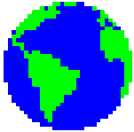

<h1>Pedro Messias</h1> 
    
 <h1> Hello World!  </h1> 

Olá! Me chamo **Pedro Messias**, tenho 24 anos. Atualmente curso **Ciência e Tecnologia na UFBA**.

Gosto de entender como as coisas funcionam por dentro e de transformar ideias em código que resolve problemas reais.

 

<h3>My Stack ~</h3>

**Back-end**

  &nbsp;
  &nbsp;
  &nbsp;
  

**Front-end**

  &nbsp;
  &nbsp;
  

**Ferramentas**

  &nbsp;
  &nbsp;
  

<h3>GitHub Stats</h3>

  
  

<picture> <source media="(prefers-color-scheme: dark)" srcset="https://raw.githubusercontent.com/PedroMessiasxD/PedroMessiasxD/output/github-contribution-grid-snake-dark.svg"> <source media="(prefers-color-scheme: light)" srcset="https://raw.githubusercontent.com/PedroMessiasxD/PedroMessiasxD/output/github-contribution-grid-snake-dark.svg">  </picture>
